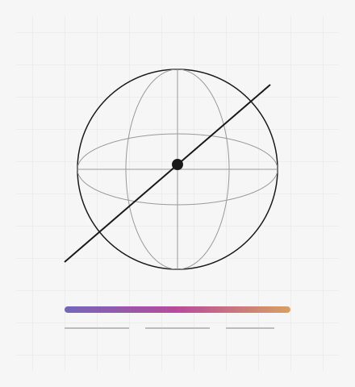

:::: {.lab-intro}
::: {.lab-bio}
# **GIBI** LAB

::: {.lab-subtitle}
空间影像 · 色彩科学 · 影像评测
:::



::: {.lab-links}
[了解课题组](about.qmd) [团队成员](people.qmd) [GitHub](https://github.com/GIBI-LAB)
:::
:::
::: {.lab-portrait}

空间几何与色彩的抽象示意图，非实验数据。
:::
::::

## 最新动态



[查看全部动态 →](news.qmd)

## 项目

:::: {.chapter-grid}
::: {.chapter}
[空间影像 →](spatial-imaging.qmd){.chapter-link}

项目资料待补充。
:::
::: {.chapter}
[色彩科学 →](color-science.qmd){.chapter-link}

项目资料待补充。
:::
::: {.chapter}
[影像评测 →](imaging-evaluation.qmd){.chapter-link}

项目资料待补充。
:::
::::

## 学术成果



[查看全部学术成果 →](publications.qmd)

::: {.content-maintenance}
[编辑课题组介绍](https://github.com/GIBI-LAB/GIBI-LAB.github.io/edit/main/content/about.md)
:::
